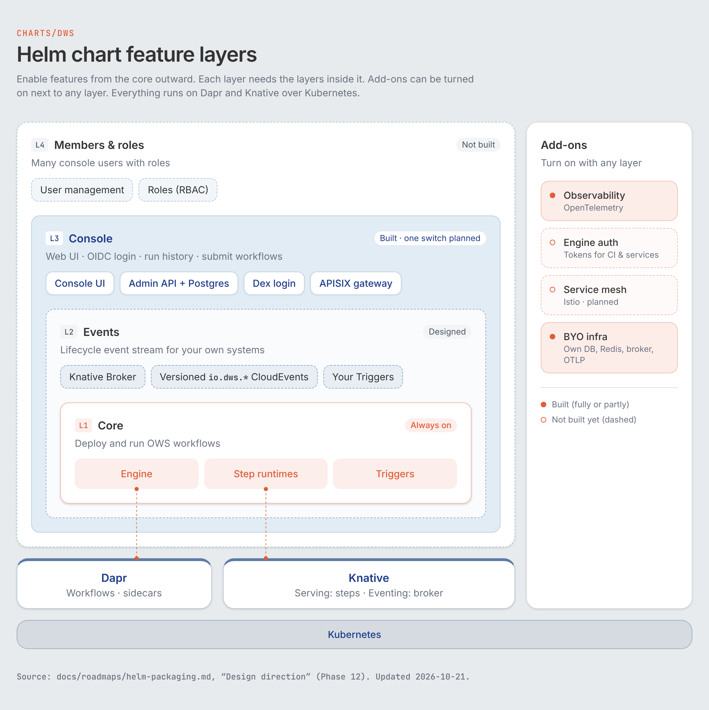
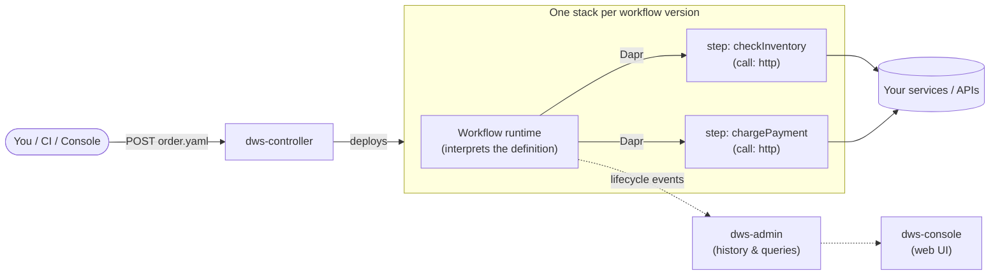

# dapr-workflow-spec (DWS)

**Run [Open Workflow Specification](https://open-workflow-specification.org/) (DSL 1.0) workflows on
Kubernetes, durably, on [Dapr](https://dapr.io/) — without writing workflow code.**

You write a workflow as plain YAML or JSON and `POST` it to DWS. DWS validates it, deploys what it
needs on your cluster, and runs it as a Dapr Workflow: retries, timers, external events, and
crash-safe replay included. Nothing is code-generated per workflow — every workflow runs on the
same prebuilt images.

## Contents

- [Features, layer by layer](#features-layer-by-layer) — what you can switch on
- [Quickstart](#quickstart) — install, deploy a workflow, run it
- [What you can write](#what-you-can-write) — supported DSL features
- [How it works](#how-it-works)
- [Installation and configuration](#installation-and-configuration)
- [Components](#components)
- [Documentation](#documentation) · [Roadmap](#roadmap) · [Contributing](#contributing)

## Features, layer by layer

Switch DWS features on from the core outward — each layer needs the ones inside it. Add-ons work
next to any layer.

<picture>
  <source media="(prefers-color-scheme: dark)" srcset="docs/roadmaps/helm-feature-layers-dark.png">
  
</picture>

| Layer | What you get | Today | Guide |
|---|---|---|---|
| **L1 Core** | `POST` a workflow, DWS deploys it; start, query, signal, pause or terminate instances. Every `call`/`run` step runtime included | ✅ Always on | [Core engine](openwiki/user-guide/core-engine.md) |
| **L2 Events** | A lifecycle event stream (deployed, started, task failed…) your own systems subscribe to, with a documented contract | ⚠️ Events always published on Dapr pub/sub; the switchable Knative Broker layer is designed | [Events](openwiki/user-guide/events.md) |
| **L3 Console** | Web UI behind OIDC login: browse workflows, watch instances live, author and submit definitions; Admin API for run history | ✅ Built, turned on with several values; one `console.enabled` switch planned | [Console](openwiki/user-guide/console.md) |
| **L4 Members & roles** | Many console users with roles | ❌ Not built | [Console](openwiki/user-guide/console.md#members--roles-planned) |

| Add-on | What you get | Today |
|---|---|---|
| Observability | OpenTelemetry traces from controller, Admin API and workflow runtimes | ✅ |
| Bring your own infra | Your Postgres, Redis, OTLP collector (broker planned) | ✅ partly |
| Engine auth | Tokens for CI and services calling the engine | ❌ planned |
| Service mesh | Istio | ❌ exploratory |

> **Today vs planned.** The chart still has one toggle per component. Chart 2.0 turns this into
> layer switches (default install = Core only, Knative bundled). Value-by-value mapping:
> [Feature layers guide](openwiki/user-guide/feature-layers.md).

## Quickstart

### 1. Prerequisites

| Need | Why |
|---|---|
| A Kubernetes cluster you can create namespaces in | — |
| [Helm 4](https://helm.sh/) (CI pins 4.3.0) | Installs DWS |
| [Knative Serving](https://knative.dev/docs/install/) | Every `call`/`run` step runs as a scale-to-zero Knative Service. **The chart does not install Knative** — pinned CRD bundles are in [`dws-controller/k8s/`](dws-controller/k8s/README.md) |
| Dapr | Bundled by the chart by default; bring your own with `--set dapr.enabled=false` |

### 2. Install DWS

```sh
helm install dws oci://ghcr.io/tonylibs/charts/dws \
  --namespace dws-system --create-namespace \
  --timeout 5m

helm test dws --namespace dws-system --logs   # optional smoke test
```

This gives you the controller, the admin API with its Postgres, Dapr, and Redis. The web console,
login, and the API gateway are off by default — see [configuration](#common-settings).

### 3. Deploy a workflow

Save this as `order.yaml` — check stock, then charge or notify:

```yaml
document:
  dsl: '1.0.0'
  namespace: default
  name: order
  version: '1.0.0'
do:
  - checkInventory:
      call: http
      with:
        method: get
        endpoint: http://inventory.local/api/check
  - decide:
      switch:
        - inStock:
            when: ${ .inStock }
            then: chargePayment
        - outOfStock:
            then: notifyOutOfStock
  - chargePayment:
      call: http
      with:
        method: post
        endpoint: http://payment.local/api/charge
  - notifyOutOfStock:
      call: http
      with:
        method: post
        endpoint: http://notify.local/api/oos
```

Then send it to the controller:

```sh
kubectl -n dws-system port-forward svc/dws-controller 8080:80 &

# Validate only — shows what would be deployed, changes nothing
curl -s -H 'Content-Type: application/yaml' --data-binary @order.yaml \
     'localhost:8080/workflows?dryRun=true'

# Deploy
curl -s -H 'Content-Type: application/yaml' --data-binary @order.yaml localhost:8080/workflows
# => {"workflow":"order","versionId":"v1a2b3c4d","version":"order@v1a2b3c4d","created":true}
```

| Response | Meaning |
|---|---|
| `201` | New version deployed |
| `200` | This exact content is already deployed — re-posting is a no-op |
| `400` | Invalid definition; the body lists every error |

Versions are content-addressed: edit the file and re-post, and a new version deploys alongside the
old one, which drains and is cleaned up automatically. Other calls: `GET /workflows`,
`GET /workflows/{name}`, `GET /workflows/{name}/plan`, `DELETE /workflows/{name}`. Full reference:
[`dws-controller/k8s/README.md`](dws-controller/k8s/README.md).

### 4. Run it

Each workflow version gets its own runtime Deployment, labelled `dws.io/workflow=<name>`:

```sh
kubectl -n dws-system get deploy -l dws.io/workflow=order
kubectl -n dws-system port-forward deploy/order-<versionId> 8081:8080 &

curl -s -XPOST localhost:8081/workflows/order/instances -d '{"orderId": 42}'
# => {"instanceId":"<id>","workflowName":"order"}

curl -s localhost:8081/workflows/instances/<id>              # status + output
curl -s -XPOST localhost:8081/workflows/instances/<id>/events/<event> -d '{}'   # feed a `listen`
```

Need pause, terminate, or your own instance IDs? Use the Dapr Workflow API on the same pod —
see [Core engine](openwiki/user-guide/core-engine.md#3-run-an-instance).

Want a UI instead? Enable the console (below) to browse workflows, watch instances live, and
submit definitions from an editor with validation and a diagram preview.

## What you can write

DWS targets the full DSL 1.0. Status today:

| Area | Supported | Not yet |
|---|---|---|
| **Calls** | `call: http`, `openapi`, `grpc` (unary), `asyncapi` (`send`), `a2a` (`message/send`, `tasks/get`) | gRPC streaming; A2A streaming |
| **Run** | `run: shell`, `run: script` (JavaScript, Python, inline source) | `run: container`, `run: workflow` (rejected at deploy time) |
| **Control flow** | `switch`, `set`, `for` (+ `while`), `fork` (join or race), `try`/`catch`/`retry`, `raise`, nested `do` | — |
| **Events & time** | `wait`, `listen` (single event), `emit` | `listen` correlation (`one`/`any`/`all`) |
| **Data** | `input.from/schema`, `output.as/schema`, `export.as/schema` | — |
| **Errors & timeouts** | RFC 7807 errors with standard error types; task and workflow timeouts | — |
| **Auth & secrets** | `basic`, `bearer`, `oauth2`; `use.secrets` (Kubernetes Secrets) | — |
| **Reuse** | — | `use.functions`, `use.catalogs`, `use.extensions` |
| **Triggers** | Deploy on `POST`, start via API | `schedule` (`every`/`cron`/`after`/`on`) |

Feature-by-feature detail: [`docs/roadmaps/openworkflow-features.md`](docs/roadmaps/openworkflow-features.md).

## How it works



1. **Deploy.** `dws-controller` validates and compiles your definition, then creates:
   - an immutable, versioned copy of the definition,
   - one Knative Service per `call`/`run` task, using the matching prebuilt step image,
   - a workflow runtime for that version.
2. **Run.** The runtime loads the definition once and walks it: `call`/`run` tasks go to their step
   service through Dapr; `switch`/`set`/`for` are evaluated with `jq`; `wait`/`listen`/`emit` map
   to Dapr timers, external events, and pub/sub. Dapr Workflow makes every step durable.
3. **Observe.** The controller and runtime publish lifecycle events (CloudEvents on Dapr pub/sub
   topic `dws.events`) — contract in [`docs/events.md`](docs/events.md). `dws-admin` stores them
   in Postgres and serves history and live updates to `dws-console`.

**Two runtimes.** The default runtime is one generic interpreter (`dws-orchestrator`) per workflow
version. A second, per-node runtime (`dws-flow` for structure, `dws-step` for activities) is being
built and can be selected with the controller's `compiler.version=v2` flag; it is early and does
not cover the full DSL yet. See
[`docs/roadmaps/workflow-runtime-architecture.md`](docs/roadmaps/workflow-runtime-architecture.md).

## Installation and configuration

DWS installs as one Helm chart, published to GitHub Container Registry as an OCI artifact. Pin a
chart version with `--version` (chart releases are cut manually — see
[`docs/release-process.md`](docs/release-process.md)).

### Use an existing Dapr

```sh
helm install dws oci://ghcr.io/tonylibs/charts/dws \
  --namespace dws-system --create-namespace \
  --set dapr.enabled=false
```

A preflight check fails the install fast if Dapr's CRDs aren't actually present.

### Upgrade and uninstall

```sh
helm upgrade dws oci://ghcr.io/tonylibs/charts/dws --namespace dws-system --reuse-values
helm uninstall dws --namespace dws-system
```

`helm uninstall` leaves the namespace, Postgres/Redis PersistentVolumeClaims, and subchart CRDs
behind — delete them yourself for a clean slate.

### Common settings

Every component also takes `image.{repository,tag,pullPolicy}`, `replicaCount`, `service.port`, and
`resources`; subchart blocks (`postgresql.*`, `redis.*`, `dex.*`, `apisix.*`) accept their upstream
chart's full schema. Annotated source of truth: [`charts/dws/values.yaml`](charts/dws/values.yaml).

| Value | Default | Effect |
|---|---|---|
| `controller.enabled` | `true` | `dws-controller` and its RBAC. Outbound-only — it deliberately gets no public route. |
| `admin.enabled` | `true` | `dws-admin` history/query API. |
| `console.enabled` | `false` | `dws-console` web UI. Has no route of its own — pair with `apiGateway.enabled`. |
| `dapr.enabled` | `true` | Bundles the Dapr control plane. `false` when Dapr is managed elsewhere. |
| `postgresql.enabled` | `true` | In-chart Postgres for `dws-admin`. Dev/eval grade: single replica, no backups. |
| `admin.database.url` / `.existingSecret` / `.existingSecretKey` | `""` | Your own database. Set one when `postgresql.enabled=false`. |
| *(Redis — no toggle)* | follows `dapr.enabled` | Backs DWS's Dapr pub/sub, definition store, and actor state store. |
| `redis.external.host` | `""` | Points those at your Redis. The in-chart Redis still installs alongside (known trade-off). |
| `auth.enabled` | `false` | JWT bearer auth on the controller. Needs `auth.issuer` + `auth.audience` (your OIDC) or `auth.dex.enabled=true`; render fails otherwise. |
| `dex.enabled` | `false` | In-chart Dex for console login. Set `dex.issuer` and `dex.consoleRedirectURI` beyond local testing. |
| `apiGateway.enabled` | `false` | Gateway API front door for the console and `/dws-admin`. Requires `auth.enabled`, `admin.enabled`, `console.enabled`. |
| `apiGateway.hostname` / `apiGateway.tls.*` | `""` / off | Public hostname and TLS Secret. |
| `apisix.enabled` | `false` | Bundles APISIX as the gateway data plane — **fresh installs only** (see below). Otherwise set `apiGateway.external.gatewayProxyName` to your own APISIX. |
| `observability.enabled` | `false` | OpenTelemetry traces, metrics, and logs to `observability.otlp.endpoint`. Needs the OpenTelemetry Operator installed first — see [chart README](charts/dws/README.md#opentelemetry-observability-phase-1). |
| `defaults.{resources,nodeSelector,tolerations,affinity}` | 100m/256Mi req, 512Mi limit | Shared pod defaults; per-component maps deep-merge, a non-empty component `tolerations` replaces the default. |
| `namespaceOverride` | `""` | Deploy into a namespace other than the release namespace. |
| `imagePullSecrets` | `[]` | Pull secrets for private registries. |

> [!WARNING]
> - **`apisix.enabled=true` works only on a brand-new `helm install`.** Turning it on with
>   `helm upgrade` deadlocks (a subchart hook waits on a Secret that is never created). Install
>   APISIX as its own release and use external mode instead.
> - **`console.ingress.enabled` no longer renders anything.** The console moved behind the Gateway
>   API front door; the old value now fails the upgrade with migration steps.
>
> Migration recipe and rollback: [`charts/dws/README.md`](charts/dws/README.md).

## Components

| Component | What it does | Stack |
|---|---|---|
| [`dws-controller`](dws-controller) | Accepts definitions, compiles them, deploys and garbage-collects each workflow version | Java, Quarkus |
| [`dws-orchestrator`](dws-orchestrator) | Default runtime — interprets one pinned definition per Deployment | Java, Spring Boot |
| [`dws-flow`](dws-flow) | Per-node runtime: structural nodes (early) | .NET |
| [`dws-step`](dws-step) | Per-node runtime: activity host (early) | Java, Spring Boot |
| [`dws-call-http`](dws-call-http) | `call: http` step image | Go |
| [`dws-call-openapi`](dws-call-openapi) | `call: openapi` step image | TypeScript, Fastify |
| [`dws-call-grpc`](dws-call-grpc) | `call: grpc` step image (unary) | Go |
| [`dws-call-asyncapi`](dws-call-asyncapi) | `call: asyncapi` step image (Dapr output bindings) | TypeScript, Fastify |
| [`dws-call-a2a`](dws-call-a2a) | `call: a2a` step image | Python, FastAPI |
| [`dws-run`](dws-run) | `run: shell` / `run: script` images (`dws-run-shell`, `-script-js`, `-script-python`) | Go |
| [`dws-admin`](dws-admin) | Turns lifecycle events into a queryable history; API behind the console | TypeScript, NestJS, Postgres |
| [`dws-console`](dws-console) | Web UI: browse, monitor, author and submit workflows | TypeScript, React, TanStack |
| [`charts/dws`](charts/dws) | Helm chart for the whole control plane | Helm |

Each component's README covers its own configuration and API.

## Documentation

| Read this | For |
|---|---|
| [User guide](openwiki/user-guide/feature-layers.md) | What each feature layer does and how to use it: install, run, events, console, add-ons |
| [DWS wiki](https://github.com/tonylibs/dapr-workflow-spec/wiki) | Setup, architecture, API, and operations guides |
| [`openwiki/quickstart.md`](openwiki/quickstart.md) | Generated, always-current guide to the codebase |
| [`docs/adr/`](docs/adr) | Architecture decisions and why |
| [`docs/roadmaps/`](docs/roadmaps/README.md) | Status of each roadmap: DSL coverage, console, auth, chart, observability, runtime |
| [`docs/events.md`](docs/events.md) | Lifecycle event contract, for building on `dws.events` |

## Roadmap

Next up for workflow authors: `schedule` triggers, `use.functions` / `use.catalogs` /
`use.extensions`, and sidecar-injected credentials. For operators: the
[feature layers](#features-layer-by-layer) as single chart switches (chart 2.0), then bringing your
own Postgres, Redis, broker, and OTLP endpoint. Design:
[`helm-packaging.md`](docs/roadmaps/helm-packaging.md#design-direction-feature-layers-and-bring-your-own-infra-proposed-2026-10-05),
[ADR 0008](docs/adr/0008-chart-bring-your-own-infra.md).

## Contributing

There is no root build: each component builds and tests on its own. Conventions, commit format,
and the exact check to run per component are in [`CLAUDE.md`](CLAUDE.md) and
[`AGENTS.md`](AGENTS.md).

**Windows dev container:** a repo on a Windows drive mounted into the Linux dev container can show
every file as changed. Run once per clone:

```sh
git config --local core.filemode false
git config --local core.autocrlf false
git config --local core.trustctime false
git config --local core.checkStat minimal
```
