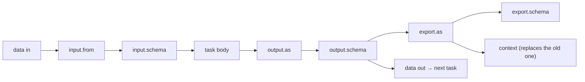

# ADR 0012: Data Flow in v2 — Node Handler Chain, Context and Step Envelope

- **Status:** Proposed
- **Date:** 2026-10-14
- **Context:** [`docs/roadmaps/workflow-runtime-architecture-roadmap.md`](../roadmaps/workflow-runtime-architecture-roadmap.md)
  Phase 2.0 item 2 (where the v1 data-flow transforms live in v2), and the `switch` seam found by 3a
  (a v2 Step returns data only, v1's `switch` also returns a next-task directive).
- **Related:** [ADR 0001](0001-workflow-runtime-v2-decisions.md) (uniform Step layer),
  [ADR 0003](0003-fork-as-a-flow-node.md) (fork as a Flow node),
  [ADR 0004 — scope nodes](0004-scope-nodes-carry-their-own-configuration.md) (Sequencer / Controller),
  [ADR 0010](0010-use-components-as-a-shared-store.md) (`UseResolver`), v1 behavior in
  `openspec/specs/workflow-data-flow/spec.md` and `DataFlowPipeline` in `dws-orchestrator`.

## Context

v1 wraps **every** task in one pipeline and keeps two documents: the **data** document that flows
task to task, and a **context** document that `export.as` writes and expressions read as `$context`.

A task that declares none of `input`, `output`, `export` skips the pipeline entirely. A failure is a
fault naming the task, the phase (`input`, `output`, `export`) and the detail.

v2 cannot carry this over unchanged:

| # | Gap | Evidence |
|---|---|---|
| 1 | `$context` has no home. The Flow-to-Step envelope is `{data, variables, workflowInstanceId, iterationIndex}` | `FlowInput`, `StepInput` |
| 2 | A Step returns data only: no new context, no `switch` directive | 3a finding 3 |
| 3 | `dws-flow` has no jq engine; only `dws-step` does | `dws-flow/src` |
| 4 | Structural tasks (`for`, `try-catch`, `fork`, `wait`, `listen`, nested `do`) can declare data flow too, and they run in Flow nodes | `TaskBase` |

## Decision 1: Node bodies never see data flow; a handler chain wraps them

Each runtime keeps its own chain of cross-cutting handlers around a node's body. The body receives the
transformed input and returns raw output; it does not know the handlers exist. A handler is installed
only when the task declares the section it serves (v1's "no overhead without data flow" rule).

| Concern | Handler? | Runs in |
|---|---|---|
| input transform and schema | yes | Step |
| output transform and schema, then `export` | yes | Step |
| task `timeout` | yes, outermost (Decision 6) | Flow |
| fault mapping | yes | Step and Flow |
| tracing, metrics, logging | yes | Step and Flow |
| `retry` | no — it belongs to the `try-catch` controller | Flow |
| `use` lookups | no — a boot-time resolver (ADR 0010) | both |
| `then` / `switch` result | no — part of the body result (Decision 4) | read by the Sequencer |

## Decision 2: Step nodes run the whole pipeline inside the Step activity

Input phase, body, output phase and export happen in one activity call: one hop, where v1 used three
activities. This applies to every Step kind, including `call`/`run`; the function image is untouched.

## Decision 3: Flow nodes get a companion Step node

`dws-flow` does not evaluate data-flow expressions. For a structural task that declares `input`,
`output` or `export`, the compiler emits **one companion Step node**, and the structural node's own
handler calls it twice: input phase before its body, output phase and export after it. The parent
Sequencer is unaware: it still calls the structural node by its type alone and may race its task
`timeout` around that call.

- Tasks without data flow emit no companion and cost nothing.
- The companion runs the same Step handlers (Decision 2), so there is one implementation.
- Cost: +1 pod per structural task that uses data flow.
- Derived identifier `<task>.dataflow`, sanitized to a DNS-1123 app ID like every other node.

## Decision 4: Envelope — `context` in, `{data, context, directive?}` out

| Direction | Fields |
|---|---|
| Flow to Step (in) | existing fields plus `context` |
| Step to Flow (out) | `data`, `context`, optional `directive` (`then` target name, `end` or `exit`) |

This replaces 3a's "a Step returns data only" and also closes the `switch` seam: a `switch` Step
returns its next-task `directive`. The Flow owns the context and threads it through every child call.
Envelope versioning is not addressed in this ADR.

## Decision 5: Context rule — v1's, adopted

The OWS specification says `export.as` replaces the context and that `$context` is readable, and is
**silent** on how context behaves across `for`, `try/catch`, `do` scopes and parallel `fork` branches.
v1 has a clear rule, verified in `InterpreterWorkflow`, and v2 adopts it:

| Scope | Rule in v1 |
|---|---|
| Sequential tasks | The context returned by one task is the next task's context |
| `for` | The context threads through the iterations and out of the loop |
| `try` body | The context written inside is returned to the parent |
| `fork` | Each branch receives the incoming context as a snapshot; the fork returns the **incoming** context, so a branch's exports are discarded |
| Start / end | `{}` at instance start; never part of the completion output |

Because fork exports are discarded, parallel branches cannot conflict. `catch` is expected to behave
like `try`; the conformance vectors (Decision 10) confirm it. No v1 change is needed.

## Decision 6: `timeout` is the outermost handler

In v1 a task `timeout` races the **whole** pipeline (input, body, output). In v2 the pipeline sits
inside the child, so the Sequencer's existing race around the child call covers it unchanged.

## Decision 7: Faults keep v1's shape for now

A data-flow fault names the task, the phase and the detail (including the offending location for a
schema failure) and surfaces through the Step failure contract from 2a. Mapping these faults to the
OWS standard error types is deferred (DF-3).

## Decision 8: Schema validation is in this phase

JSON Schema 2020-12, inline schemas only. `schema.external` and non-`json` formats fail the task and
name the unsupported form, as in v1. Embedded schemas enlarge the node definition; the size is assumed
small and no guard is added.

## Decision 9: jq builtin policy *(confirmed 2026-10-14; delivered as separate tasks 2i for v2 and 5.2 for v1)*

v1 loads the **entire** jq 1.6 builtin set with no deny list (jackson-jq, `JqEvaluator`), while its
javadoc calls evaluation "pure and deterministic". All jq in v2 data flow runs inside Step activities,
whose results are recorded, so determinism is not a correctness issue; hermeticity and secret leakage
are. Proposed policy:

| Builtins | Policy | Why |
|---|---|---|
| `env`, `$ENV` | block | Exposes the pod's environment |
| `input`, `inputs`, `input_filename` | block | Not meaningful, reads outside the document |
| `import`, `include` | block | Loads modules from disk |
| `halt`, `halt_error` | block | Terminates the evaluator |
| `debug`, `stderr` | block | Writes workflow data to logs |
| `now` and the local-time functions | allow | Useful; a retried activity re-evaluates, which is acceptable |

Which of these the engine actually exposes is confirmed by the conformance vectors, not assumed.

## Decision 10: One shared conformance corpus

A golden corpus, run by v1, by the v2 Step handlers and by the Flow companion path: v1's
`dataflow.yaml`, the scenarios in `workflow-data-flow/spec.md`, the context cases of Decision 5
(sequence, `for`, `try`, `catch`, `fork` snapshot), schema failures and the Decision 9 builtins.

## Deferred and follow-up work

| Id | Work | Status |
|---|---|---|
| DF-1 | Policy for secrets exported into `$context`: the context sits in workflow history in plain text | Deferred |
| DF-2 | Payload size guard: context and data travel on every call and are stored in history | Not started |
| DF-3 | Map data-flow faults to the OWS standard `validation` / `expression` error types, so `catch` can match them | Not started |
| 5.1 | Run the shared corpus on v1; fix divergences, including the schema dialect | Not started |
| 2i | Apply the Decision 9 builtin policy in the `dws-step` evaluator | Not started |
| 5.2 | Apply the Decision 9 builtin policy in the v1 evaluator | Not started |

## Open

- **Flow expression evaluation.** `dws-flow` has no jq engine, yet 3b (`for` `in`/`while`) and 3g
  (`listen` `data` matching) must evaluate expressions. This ADR does not decide it (roadmap 2.0c). If a
  .NET engine is chosen, Decision 3 can be revisited.
- Document-level (workflow) `input`/`output` are not used by v1 and stay out of scope.

## Consequences

- The Step output shape changes. 2a and 3a were merged against the old shape and need a small patch.
- 2b gains a clear owner for its `switch` directive.
- New work, tracked in the roadmap: 2.0b (shared corpus), 2.0c (Flow expression strategy), 2h (Step
  handlers and envelope), 3k (Flow handlers and context threading), 5.1 (v1 conformance), and
  companion-node emission added to the Phase 1 follow-up.

## Alternatives rejected

- **Wasm middleware for input and output in the step sidecar.** It cannot cover `set`/`switch`/`emit`/
  `raise` (no function call), structural tasks, `export`/`$context`, or schema validation ordering, so
  the Step would still need the full pipeline. The reason Wasm suited auth (credentials must not reach
  the image) does not apply, and the Dapr docs describe only a request-phase handler, so response
  rewriting is unproven.
- **Three activities per task, as in v1.** Extra hops for no benefit once the handlers sit in the Step.
