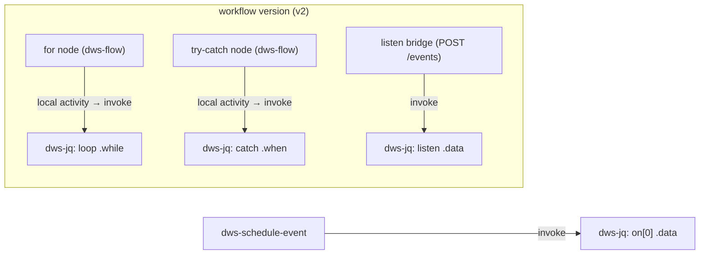

# ADR 0014: Flow and Trigger Expressions Run in a Per-Expression `dws-jq` Function

- **Status:** Accepted (2026-11-24). Decision 9 amended the same day (2.0d answers O-1 to O-6)
- **Date:** 2026-11-24
- **Context:** [`docs/roadmaps/workflow-runtime-architecture-roadmap.md`](../roadmaps/workflow-runtime-architecture-roadmap.md)
  row 2.0c, the "Open" item of [ADR 0012](0012-data-flow-in-v2-node-handlers.md) (Flow expression
  evaluation), and [`docs/roadmaps/openworkflow-features.md`](../roadmaps/openworkflow-features.md) Phase 6b
  (`schedule.on` data filters and `correlate`).
- **Related:** [ADR 0001](0001-workflow-runtime-v2-decisions.md) (per-node app IDs, plain-HTTP function
  images), [ADR 0006](0006-wait-and-listen-as-flow-controllers.md) (`listen` controller and bridge),
  [ADR 0012](0012-data-flow-in-v2-node-handlers.md) (data flow, Decision 9 builtin policy),
  [ADR 0013](0013-time-triggers-in-dws-schedule-time.md) (trigger components, start contract).

## Context

Only `dws-step` and v1 (`dws-orchestrator`) have a jq engine: jackson-jq 1.2.0 with the jq 1.6 builtin
set. ADR 0012 put every data-flow transform in a Step node, and gives structural tasks a companion Step
node for `input`/`output`/`export`. It left open how a **Flow** node evaluates its *own* expressions,
such as a loop's `while`.

Two .NET hosts now need jq:

- `dws-flow`, a Dapr workflow host. Its workflow code must stay deterministic on replay.
- `dws-schedule-event` (Phase 6b, .NET 10). It is a plain service, not a workflow, so it cannot call an
  activity.

v1 already evaluates loop and catch expressions **one activity call per evaluation**: `for.in` and
`while` each run in their own activity, and the catch/retry `when`/`exceptWhen` conditions run in the
catch policy. An extra hop per evaluation is therefore not a new cost.

### Inventory

Every expression that a Flow node or a trigger evaluates itself:

| Site | Owner | v1 today | v2 evaluator | Roadmap | Bound as `.` and `$name` |
|---|---|---|---|---|---|
| `for.in` | `for` controller | activity, once per loop | `dws-jq` | 3b | data; `$context` |
| `for.while` | `for` controller | activity, once per iteration | `dws-jq` | 3b | data; `$context`, loop variables (`each`, `at` names) |
| `catch.when`, `catch.exceptWhen` | `try-catch` controller | catch policy | `dws-jq` | 3c | data; `$context`, the caught error (`catch.as`, default `error`) |
| `catch.retry.when`, `catch.retry.exceptWhen` | `try-catch` controller | catch policy | `dws-jq` | 3c | as above |
| `listen.to` `with` values given as runtime expressions, `correlate.expect` | `listen` workflow, at registration | not supported | `dws-jq` | 3f | data; `$context` |
| `listen.to` `until`, where the DSL allows an expression | `listen` workflow | not supported | `dws-jq` | 3f | data; `$context` |
| `listen` `with.data`, `correlate.from` | `listen` bridge (`POST /events`) | not supported | `dws-jq` | 3g | the event |
| `schedule.on` `with.data`, `correlate.from`, `until` expression | `dws-schedule-event` | rejected by the controller | `dws-jq` | 6b | the event |
| Task-level `if` | parent Sequencer | not evaluated by v1 | `dws-jq`, once supported | not scheduled | data; `$context` |

These stay in Step nodes and are **not** affected: `input.from`, `output.as`, `export.as` (structural
tasks through their companion node, ADR 0012 Decision 3), `set`, `switch` `when`, `emit`, `raise`, and the
arguments of `call`/`run`.

## Decision 1: One `dws-jq` function per expression

- A new Go component, `dws-jq`, built on the gojq library, in the same family as `dws-call-http` and
  `dws-run`.
- The controller deploys **one** `dws-jq` instance per expression site per workflow version, as a
  Dapr-enabled Knative Service serving plain HTTP, like the other function images.
- The expression and the names of the variables it may use are fixed in the deployment's configuration.
  The function compiles and checks them once at startup (Decision 6) and evaluates only that expression.
  No endpoint anywhere accepts expression text.
- A `dws-jq` instance is **not a graph node**. No parent calls it as a child. It belongs to the node or
  trigger that owns the site, and is deployed and removed with that workflow version like every node.



## Decision 2: How callers reach it

| Caller | How | Why |
|---|---|---|
| `dws-flow` workflow code (3b, 3c, 3f) | Its own local activity, which invokes `dws-jq` through Dapr service invocation | The result is recorded in workflow history, so replay stays deterministic and `now` is safe (Decision 9 of ADR 0012 allows it) |
| `listen` bridge (3g) | Direct service invocation from its event handler | Not workflow code; nothing is replayed |
| `dws-schedule-event` (6b) | Direct service invocation | Not a workflow |

- A Dapr access policy on each `dws-jq` app admits only its owner's app ID.
- With auth on, callers send their own Dapr API token, as `dws-schedule-time` does. The .NET
  invocation client does not read it from the environment; see root `CLAUDE.md`.

## Decision 3: Contract

**Request:** `POST /run` (the path the other function images use, roadmap 2e):

```json
{ "input": <any JSON>, "variables": { "<name>": <any JSON> } }
```

- `input` is bound to `.`, and each variable to `$<name>`.
- Only names declared at deploy are accepted. A declared variable left out of the request is `null`. An
  undeclared name is a `400`.
- `$secrets` is never passed in a request. A function whose expression uses `$secrets.<name>` reads
  those names itself (Decision 9, O-5).
- Both `${ ... }` and bare jq are accepted, as in v1.

**Success:** `200`

```json
{ "result": <first output, or null if none>, "truthy": <boolean> }
```

- `result` and `truthy` follow v1 exactly: the first output only, and everything except `null` and
  `false` is true.
- A condition site reads `truthy`; a value site (`for.in`, `correlate.from`) reads `result`. Truthiness is
  decided in one place.

**Expression failure:** `422`

```json
{ "fault": { "type": "expression", "expression": "<text>", "detail": "<reason>" } }
```

- This covers evaluation errors and the per-evaluation time limit. The limit is set at deploy, with a
  default of 5 s, so a runaway generator cannot hold a loop forever.
- The caller fails the owning task with a fault naming the task, the site (for example `for.while`) and
  the detail.
- `type: expression` matches the OWS standard error type that DF-3 will map to. Until DF-3 lands, the
  fault keeps v1's shape (ADR 0012 Decision 7).
- Transport and sidecar failures are never `422`. The Flow activity reports them under the 2a Step
  failure contract, where `502` is reserved for transport failure.

## Decision 4: Builtin policy is enforced at startup

gojq behaves differently from jackson-jq on the builtins that ADR 0012 Decision 9 blocks. jackson-jq does
not implement most of them, so they already fail to compile. gojq does implement them:

| Builtin | gojq | `dws-jq` |
|---|---|---|
| `env`, `$ENV` | exist; return `{}` (OS environment hidden by default) | reject |
| `input`, `inputs` | exist; fail without an input iterator | reject |
| `input_filename` | exists; returns `null` | reject |
| `import`, `include` | parse; fail without a module loader | reject |
| `halt`, `halt_error` | exist | reject |
| `debug`, `stderr` | exist | reject |
| `now`, date and local-time functions | exist | allow |

- `dws-jq` walks the parsed expression at startup and rejects any use of a blocked builtin, with an error
  that names the builtin.
- As a second guard, it installs no environment loader, no input iterator and no module loader.
- The 13 cases in `conformance/data-flow/cases/builtins/`, run as expression vectors (Decision 5), are
  the acceptance test.

## Decision 5: Two engines, one documented dialect, one expression corpus

The system now runs two jq engines:

- jackson-jq (jq 1.6 builtins) in Step nodes and v1;
- gojq (close to jq 1.7, the version the corpus expectations were computed with) in `dws-jq`.

They cannot be made identical: gojq always sorts object keys. The decision is to **document** the
difference and **measure** it, not hide it.

| Behavior | jackson-jq 1.2.0 (Step, v1) | gojq (`dws-jq`) | Status |
|---|---|---|---|
| Object key order | insertion order | always sorted: affects `to_entries`, `tostring`/`tojson` of objects | known |
| `keys_unsorted` | expected (jq 1.6 builtin) | missing: the expression fails at startup | gojq side known; jackson-jq side to confirm with the corpus |
| Date and local-time functions | only `now`, `todateiso8601`, `fromdateiso8601` | full set (`todate`, `mktime`, `strftime`, `localtime`, …) | known (corpus `builtins/clock-local-time`) |
| Integer precision | to confirm | arbitrary precision for `+ - * %` and exact division | to confirm |
| String indexing (`"abcde"[2]`) | to confirm | intentionally differs from jq | to confirm |
| Regex | to confirm | no look-around, no backreferences, some flags missing | gojq side known |
| `$__loc__`, `input_line_number`, `get_*_origin` | to confirm | unsupported | gojq side known |

- The dialect users can rely on for Flow and trigger expressions is **gojq's, minus the Decision 9
  builtins**. The user documentation states the rows above.
- A new expression-level corpus, `conformance/expressions/`, is language-neutral like
  `conformance/data-flow/`. Each vector is an expression, an input, variables, and the expected `result`
  and `truthy`, or a fault. Each engine has its own divergence list, with the same stale-divergence rule.
- The corpus is seeded with the builtin cases above, one case per row of the table, and the expressions
  the v1 tests use for `for`, `while` and catch.
- `dws-jq` runs it in 2j. A jackson-jq runner (EX-1) turns the "to confirm" cells into fact and shows
  exactly where a Step expression and a Flow expression can disagree.

## Decision 6: A bad expression fails the function at startup

- The controller is Java. It cannot parse gojq's dialect, and checking with jackson-jq would accept or
  reject the wrong expressions.
- `dws-jq` compiles the expression and applies Decision 4 at startup. On failure it logs one structured
  error naming the expression and the reason, and exits without becoming ready.
- The Knative revision then never becomes ready. The controller must report that version's deploy as
  failed, naming the owner task, the site and the reason (Phase 4 for v2, 6b for v1 triggers).
- Consequence: the dry-run plan does not catch jq errors. This matches v1 today, where the controller
  has no jq engine and expressions compile only when first evaluated. A submit-time check that reuses the
  same binary is follow-up EX-2.

## Decision 7: Identity and wiring

- Each site gets the derived identifier `<owner>.jq.<site>`, for example `processItems.jq.while`,
  `fulfillOrder.catch.jq.when` or `<workflow>.on.0.jq.data`.
  - It is sanitized to a DNS-1123 app ID by the same rule as every node (ADR 0001).
  - A collision with any other app ID in the version is a compile error.
- The owner's definition carries, at each site, the `dws-jq` app ID to call, plus the expression text for
  logs and faults:
  - for v2, that is the single-node definition schema (a Phase 1 follow-up change);
  - for 6b, it is the `kind: event` trigger ConfigMap.
- The controller deploys and removes them per workflow version:
  - v2 in Phase 4 deploy synthesis;
  - v1 `schedule.on` in 6b. The v1 path already renders Knative Services for its function images.

## Decision 8: Cost

- **Pods:** one per expression site per version. A typical workflow has a handful of sites.
- **Scaling:** scale-to-zero (`min-scale: 0`), as the existing plain-HTTP function images already do.
  - A cold start is paid on the first evaluation after an idle period, and is most likely dominated by
    the Dapr sidecar rather than the small Go binary.
  - A `while` loop pays it once per burst, not once per iteration, because the pod stays warm between
    iterations.
- **Hops:** one activity plus one service invocation per evaluation from workflow code. This matches
  v1's one activity per evaluation.
- Busy sites get `min-scale: 1` (Decision 9, O-1). Which sites count as busy is set with measurements
  from the 3h exit gate and 6b (EX-3).

## Decision 9: Every jq evaluation in DWS converges on `dws-jq`

*Added 2026-11-24.* Using `dws-jq` only for Flow and trigger expressions would leave three jq
implementations in the system. Instead, every component that embeds a jq engine plans to migrate to
`dws-jq`, and no new component embeds one.

| Host | Engine today | Expressions it evaluates | Migration |
|---|---|---|---|
| `dws-flow` | none | `for`, catch/retry conditions, `listen` | Born on `dws-jq` (3b, 3c, 3f, 3g) |
| `dws-schedule-event` | none (not built) | `schedule.on` filters, `correlate`, `until` | Born on `dws-jq` (6b) |
| `dws-step` | jackson-jq 1.2.0 (jq 1.6 builtins) | `set`, `switch`, `emit`, `raise`, `input`/`output`/`export` (companion nodes included), `call`/`run` arguments | 2k |
| `dws-orchestrator` (v1) | jackson-jq 1.2.0 | everything v1 evaluates | 5.3 |
| `dws-call-openapi`, `dws-call-asyncapi` | node-jq (runs the jq binary) | `with` parameters | 2l |
| `dws-call-a2a` | jq.py (bundled libjq) | `with` parameters | 2l |
| `dws-call-http`, `dws-call-grpc`, `dws-run` | none | receive values already evaluated | — |

**What this buys:**
- One dialect. The two-engine table of Decision 5 becomes a temporary list that shrinks to nothing as
  2k, 5.3 and 2l land.
- One place enforces the builtin policy.
- One corpus runner.
- Phase 5 parity compares v1 and v2 on the same dialect.

**Settled 2026-11-24 (roadmap row 2.0d):**

| # | Question | Decision |
|---|---|---|
| O-1 | Granularity at Step/v1 scale | **Keep one function per expression.** Busy sites get `min-scale: 1`; everything else scales to zero. *Still to define:* which sites count as busy (for example, inside a loop or on a hot path, from EX-3 measurements, or an author hint) |
| O-2 | Structured templates (`set`, `input.from`, `output.as`, call arguments with many `${ }` parts) | **The compiler rewrites each field into one jq expression.** Objects become `{ "key": (…) }` with keys always quoted, arrays become `[ … ]`, and constants are written as JSON. Each `${ expr }` part becomes `([ expr ] \| .[0])`, which keeps v1's first-result-or-`null` rule and keeps `as $x` bindings inside the part. v1's two rules are applied per place: in `set` every string is an expression; elsewhere only `${ }` strings are. A field with no parts gets no function: its constant goes into the definition. So one function per expression still holds. Trade-off: a fault names the field, not the part. The expression corpus adds combined cases (a part using `def`, `as $x`, `empty`, several results) |
| O-3 | ADR 0012 Decision 2's one-hop Step pipeline | **Accepted:** a migrated Step makes one `dws-jq` call per expression. No batching |
| O-4 | Who evaluates function images' `with` parameters | **`dws-jq` evaluates them.** The caller (Step in v2, the orchestrator in v1) gets the values from `dws-jq` and passes them on; images never evaluate jq |
| O-5 | `$secrets` | **Option B, `dws-jq` reads its own secrets.** At deploy the controller finds which `$secrets.<name>` an expression uses and grants that `dws-jq` app read access to exactly those names in the version's secret store, through that app's Dapr Configuration secret scopes (to confirm against the Dapr docs). The function fetches them itself, so secrets never appear in a request or in workflow history. Every `dws-jq` replaces any secret value it holds with `***` in fault details and logs. *Still to define:* dynamic access (`$secrets[.key]`): reject it, or grant every secret in `use.secrets`; and in which expressions `$secrets` is allowed (v1's `set`/`switch` set, the OWS `input.from`, or both) |
| O-6 | Interim work and v1 | **v1 migrates (5.3).** 2i, 5.2 and EX-1 stay as stop-gaps until 2k and 5.3 land |

## Consequences

- New roadmap row **2j**, building `dws-jq`: the Go package, the contract, the startup policy, the
  `conformance/expressions/` corpus with its `dws-jq` runner, and CI and release wiring. It depends on
  this ADR.
- 3b, 3c, 3f, 3g and 6b depend on 2j. The Flow-side activity that calls `dws-jq` is part of each of those
  rows.
- The compiler gains per-site emission (Phase 1 follow-up schema change, Phase 4 synthesis, 6b for v1),
  plus the access policy per `dws-jq` app.
- The "Open" item of ADR 0012 is closed. Its Decision 3 (companion Step node) is unchanged.
- Expressions behave slightly differently depending on where they run (Decision 5). This is documented
  and measured rather than hidden.
- Decision 9 plans every other jq host onto `dws-jq`: design row 2.0d, then migrations 2k (`dws-step`), 5.3
  (v1) and 2l (function images). No new component embeds a jq engine.

## Follow-ups

| Id | Work | Status |
|---|---|---|
| EX-1 | jackson-jq runner for `conformance/expressions/` (Step and v1), with its own divergence list. Needed only until 2k and 5.3 land (Decision 9) | Not started |
| EX-2 | Submit-time expression check using the `dws-jq` binary (controller dry-run or `dws-admin` validation) | Deferred |
| EX-3 | Measure cold start and per-evaluation latency, before 2.0d settles O-1; decide whether some sites need `min-scale: 1` | Measured 2026-11-25 on a local cluster ([`dws-jq/README.md`](../../dws-jq/README.md#ex-3-results)); the "which sites need `min-scale: 1`" decision is **open**, see 2j notes |

### 2j notes (2026-11-25)

Recorded while building `dws-jq` (roadmap row 2j). No decision above is changed.

**Decision 5, gojq-side cells confirmed** by `conformance/expressions/cases/dialect/*`, run by `dws-jq`
(55 of 55 corpus cases pass on gojq v0.12.20; the `dws-jq` divergence list is empty):

| Cell | Observed on gojq |
|---|---|
| Integer precision | `9007199254740993 + 1` is `9007199254740994` |
| String indexing | `"abcde"[2]` is `"c"` |
| Regex look-around | `test("a(?=b)")` is an **evaluate-phase** fault (`invalid or unsupported Perl syntax`), not a startup error |
| `keys_unsorted` | compile fault, so `dws-jq` fails at startup |
| `$__loc__` | compile fault. `input_line_number` also fails to compile (pinned in `internal/expr/program_test.go`); `get_*_origin` is not pinned by a test |
| Key order, date functions | as the table states |

The jackson-jq column of those rows stays "to confirm" until EX-1.

**O-5, dynamic access.** `dws-jq` rejects every non-static `$secrets` use at startup, naming the form it
found. Only `$secrets.name`, `$secrets."name"` and `$secrets["name"]` are accepted. This answers the
2.0d question "dynamic `$secrets[...]` access" with *reject*; a computed choice is still possible as
`if .x then $secrets.a else $secrets.b end`. The reason is that `$secrets[.key]` could not be scoped to
a named secret, so the controller's static scan would be unsound. The other open half of O-5 (which
expressions may use `$secrets`) is not answered by `dws-jq`, which accepts it in any expression it is
configured for. One addition not in the ADR: a secret named `bulk` is refused, because
`GET /v1.0/secrets/{store}/bulk` is Dapr's bulk route and would return the whole store.

**EX-3.** Measured 2026-11-25 (local Docker Desktop cluster, Knative 1.24.0, Dapr 1.19.1; numbers in the
`dws-jq` README). Warm evaluation through Dapr invocation: p50 2.4 ms, p95 3.5 ms over 200 calls. A cold
start through the Knative route: about 1 s (0.92 to 1.02 s, five samples), with the image already on the
node.

**What turned out wrong or incomplete:**

1. **Decision 2 and Decision 8 assume a scaled-to-zero site wakes on invocation. With Dapr service
   invocation it does not.** In all five cold samples the call failed within 6 ms with `500
   ERR_DIRECT_INVOKE` ("failed to resolve address for `<app-id>-dapr.<ns>.svc.cluster.local` ... no such
   host") and no pod was started: Dapr resolves the callee through the `<app-id>-dapr` headless Service,
   which has no address at zero pods, so the Knative activator never sees the request. Only a request
   through the Knative route wakes the revision, and after it did, Dapr invocation still failed for
   several seconds (about 20 s after pod creation in the one run that was timed). Decision 8's "a cold
   start is paid on the first evaluation" is therefore not true for callers that use Dapr invocation,
   which Decision 2 prescribes for all three callers. For O-1 this means `min-scale: 1` is not only an
   optimisation for busy sites: any site whose caller cannot tolerate a failed first call needs it, or
   the caller needs a wake-up step or retry. Roadmap row 2.0d must settle this; it was not decided here.
   One run on one cluster, but the cause is Dapr's name resolution, not this cluster.
2. **Decision 4's table is wrong about gojq as a library.** It says `input_filename` "exists; returns
   `null`", and that `debug` and `stderr` "exist". Run as a library (the way `dws-jq` uses it, not the
   `gojq` command), v0.12.20 does not define `input_filename`, `debug` or `stderr` (`function not
   defined: input_filename/0`, and so on), and `input`/`inputs` fail to compile with `input(s)/0 is not
   allowed` rather than failing at run time. `env` and `$ENV` do exist and return `{}`, `halt` and
   `halt_error` exist (they stop evaluation with a halt error), and `import` fails with `cannot load
   module`. This does not change the decision: `dws-jq` still rejects all of them by name at startup,
   so a future gojq that defines `debug` or `input_filename` cannot slip through. It does mean the table
   describes the command-line tool for those rows.
3. Decision 4 says the 13 cases in `conformance/data-flow/cases/builtins/` are the acceptance test. The
   `dws-jq` corpus carries them plus look-alike cases (`.env`, `{debug: 1}`, `"input"`) to show the
   by-name check does not reject field names, object keys or strings.

## Alternatives rejected

- **A .NET jq engine inside `dws-flow` and `dws-schedule-event`.**
  - It adds a third engine and dialect to keep aligned, and still needs its own deny list.
  - Inside workflow code it would still have to run in an activity, to keep `now` replay-safe.
  - ADR 0012 Decision 3 would have to be reopened.
- **Evaluating in a companion Step node.**
  - It means a JVM pod per site.
  - `dws-step` is an activity host, so the `listen` bridge and `dws-schedule-event` cannot call it.
- **One shared `dws-jq` per install, with the expression in each request.**
  - It puts a service in the cluster that evaluates any jq anyone may send.
  - Every workflow depends on one deployment.
  - Expressions are never checked before first use.
- **One `dws-jq` per workflow version.**
  - Fewer pods, but one bad expression takes every site of the version down.
  - Each request must say which expression to run.
  - One expression per function keeps the contract and the failure scope minimal.
- **Restricting the expression forms the Flow accepts.** It drops spec coverage that v1 has today
  (`for.in`, `while`, catch conditions) and that `listen` and `schedule.on` need.
