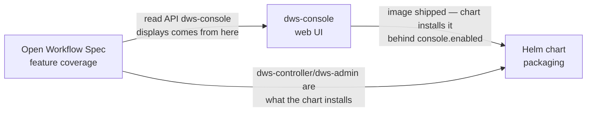

# Roadmaps

Seven independent roadmaps, one per surface. Each moves on its own timeline and has its own
"done" bar — read the one relevant to what you're touching.

| Roadmap | Surface | Current phase |
|---|---|---|
| [Open Workflow Spec feature coverage](openworkflow-features.md) | `dws-controller` + `dws-orchestrator` — DSL 1.0 task types and cross-cutting features | Updated 2026-11-02. Phases 0–5 done (Phase 4 auth + secrets archived 2026-10-05 after the live OAuth probe passed). **Phase 4.1** (credentials via sidecar Wasm, ADR 0010) in progress: 4.1a, 4.1b and 4.1c-bearer (`dws-mid-bearer` 0.1.0) done; 4.1c-basic (`dws-mid-basic` 0.1.0) merged, only the published-image check left; 4.1d–4.1h next. Phase 5.5 (A2A), 6 (scheduling) and 7a–7c (`use.*`) not started |
| [`dws-console` web UI](dws-console.md) | Operator-facing web app (TanStack Start) + `dws-admin` push API | Phases 0–3 and 6 done — workflow browser + instance monitor wired live to `dws-admin` (SSE push, no polling), shipped as a container image built/smoke-tested by CI. Phase 4 (definition submission) done — tracked in detail as the submission roadmap's Phase 1 (editor) + Phase 2 (validation preview); Phase 5 (auth) is ⚠️ partial because its Dapr-gated write path remains, while the console OIDC client is done and bundled-IdP interoperability is deferred to auth-roadmap Phase 8. Detailed sequencing is split across [`dws-console-submission.md`](dws-console-submission.md) and [`dws-auth.md`](dws-auth.md) |
| [`dws-console` definition submission](dws-console-submission.md) | Console-side authoring UX: raw YAML/JSON editor, file upload, dry-run validation, read-only graph preview, exploratory editable canvas | Phases 1–4 done: definition editor, validation preview (two-layer spec + deployability validation, 2026-09-04), file import + persisted draft (2026-09-05), and workflow diagram (execution-view graph with `@xyflow/react` + `elkjs`, 2026-09-29). Submission goes through the authenticated `dws-admin` relay (OIDC bearer, same-origin `/dws-admin` via the Gateway). Phase 5 (visual editor) exploratory |
| [`dws-console` auth](dws-auth.md) | Login (OIDC/PKCE in the console) + a Dapr-gated write path from `dws-admin` to `dws-controller` | Updated 2026-11-02. Phases 0, 1, 2, 4, 5, 6 done. **Phase 10** (Dapr API token + app API token) done: live verified 2026-10-31, merged 2026-11-02 (change `auth-phase-10-api-tokens`, not yet archived); controller app-port bypass stays a scoped follow-up. Phase 8 (bundled-IdP sessions, RP logout) deferred; Phase 11 (Istio) exploratory |
| [Helm chart packaging](helm-packaging.md) | `charts/dws` — cluster install of the control plane | **Phases 0–10 done** (updated 2026-09-19): control plane (controller, admin+DB with in-chart Postgres), Dapr as a conditional chart dependency + preflight check + sidecar self-heal hook, in-chart Bitnami Redis tied to `dapr.enabled` backing the `pubsub`/`dws-definitions`/actor-statestore Components with an end-to-end pub/sub assertion in CI, console templates behind `console.enabled` routed by the shared `apiGateway.*` Gateway API front door (which superseded the console-only Ingress and the nginx admin gateway), shared `defaults.*` pod config across every chart-owned Deployment, lint/template/kind-integration CI plus shell render-assertions, OCI publish to ghcr.io, and install/values documentation across the root README, `charts/dws/README.md` and `CLAUDE.md`. **Phase 11 (Knative — split out of Phase 4) is the only open phase**: entirely unstarted, independent of everything else, and arguably optional since `dws-controller` already ships pinned Knative bundles operators can apply themselves. **Phases 12 (feature layers) and 13 (bring-your-own infra) proposed 2026-10-05**, design only |
| [Observability](observability.md) | Cross-cutting — OpenTelemetry metrics, traces, and logs from every DWS component, chart-managed and controller-stamped alike | Updated 2026-11-02. Track A: Phase 0-A, **1** (controller + admin), **2a** (orchestrator tracing, 2026-10-06) and **4** (log ↔ trace correlation, live evidence 2026-10-31; change not yet archived, follow-ups #178–#182) done. 2a′ (Flow/Step) waits for runtime Phase 4. Track B (0-B, 2b, 3) deferred. Phase 5 (domain metrics), 6 (bundled collector) and 7 (docs + CI) not started |
| [Target workflow runtime and visual architecture](workflow-visual-model.md) | Target .NET Flow, Java/Spring Step, Knative function delegation, and matching structural visual model | 🟡 Updated 2026-11-02. Phases 0–1 done. Phase 2: 2a and 2.0b (data-flow conformance corpus) done, ADR 0012 accepted 2026-11-02; 2h, 2i, 2.0c ready. Phase 3: 3a and 3i (.NET `UseResolver`) done, 3j ready; 3k after the Phase 1 follow-up (now ready). 5.1 met by 2.0b. Phases 4–5 not started. Tracked in [workflow-runtime-architecture-roadmap.md](workflow-runtime-architecture-roadmap.md) |

## How they relate

- **OWS feature coverage** drives what `dws-admin`'s read model and API can show — `dws-console`
  is a consumer of that API, not an independent source of truth.
- **`dws-console`** no longer blocks Helm packaging: the console image shipped, Phase 6 is done, and
  the chart installs the console behind `console.enabled` with routing from its shared Gateway API
  front door (see [helm-packaging.md](helm-packaging.md)).
- **Helm packaging** is otherwise independent of DSL feature work — it only cares that
  `dws-controller`/`dws-admin` exist and expose a stable container image + config surface.

## Status legend

Used consistently across all docs: ✅ done · ⚠️ partial/stubbed · ❌ not started.
