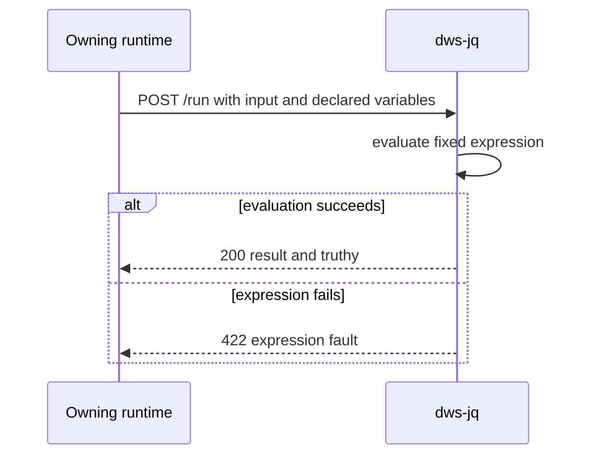

# DWS jq expression service

`dws-jq` evaluates **one jq expression fixed at deployment**. It is built and tested in this
repository, including its expression conformance corpus, but it is **not yet deployed by the
controller or included in chart 1.x workflow deployments**. It therefore does not change what a
workflow author can deploy today.

The runtime-v2 design makes `dws-jq` the expression boundary for Flow controllers such as `for`,
`try`/`catch`, and `listen`; [the Flow host](flow-host.md) will call it through a local activity so
its result is recorded in Dapr Workflow history. Planned controller work will deploy one instance
per expression site and version; the full status and dependency order live in the
[OWS DSL feature roadmap](roadmap.md#phased-roadmap).

## Contract

A deployment sets `JQ_EXPRESSION` to either bare jq or one outer `${ ... }` wrapper. It compiles
that expression once at startup. `JQ_VARIABLES` may declare the variable names callers can provide;
`JQ_TIMEOUT` bounds each evaluation and defaults to five seconds.

Callers use `POST /run`:

```json
{
  "input": { "amount": 42 },
  "variables": { "limit": 100 }
}
```

`input` is jq `.`, and a declared variable becomes `$<name>`. Both fields are optional: omitted
input and declared variables are `null`. Expression text is deliberately **not** accepted in a
request.

| Response | Meaning |
|---|---|
| `200 {"result":…, "truthy":…}` | First jq output, or `null` when there is no output; only `null` and `false` are falsy. |
| `400 {"error":…}` | Bad JSON shape, an unknown field, an undeclared variable, or a body larger than 4 MiB. |
| `422 {"fault":{"type":"expression",…}}` | A jq evaluation error, `error(...)`, timeout, or unencodable result. |
| `503 {"error":"not ready"}` | Startup has not completed. |

`GET /healthz` returns the configured site and `200` only after configuration, expression checking,
and required secret reads succeed. A failed startup exits instead of accepting traffic with a bad
expression.



This request flow never carries expression text; startup has already compiled and checked it.

## Expression and secret safety

The service rejects at startup the builtins that could inspect its environment, stream input, load
modules, halt, or write diagnostics: `env`, `$ENV`, `input`, `inputs`, `input_filename`, `import`,
`include`, `halt`, `halt_error`, `debug`, and `stderr`. It also installs no environment, input, or
module loader.

An expression can reference `$secrets`, but only with a static name such as `$secrets.token` or
`$secrets["api-token"]`. At startup, the service reads only those names through the configured Dapr
secret store and keeps them in memory. Dynamic forms such as `$secrets[.key]`, iteration, and bare
`$secrets` are rejected because their secret scope cannot be derived safely. Faults, bad-request
messages, and logs redact loaded secret values; an expression result is not redacted.

This service-level policy is separate from the existing v1 workflow secret projection described in
[Deployed workflow lifecycle](deployed-workflow.md#secrets-and-authorized-steps). Controller work
still has to grant each planned per-expression service access to the exact static names it needs.

## Dialect and verification

`dws-jq` uses gojq v0.12.20. Its supported dialect is gojq minus the blocked builtins above. In
particular, object keys are sorted, `keys_unsorted` and `$__loc__` fail to compile, local-time
functions are available, integer arithmetic preserves precision, string indexing returns a
character, and regular expressions use RE2 (no look-around or backreferences).

The language-neutral [`conformance/expressions/`](../../conformance/expressions/README.md) corpus
pins the HTTP result/truthiness contract, builtin policy, dialect behavior, and v1-shaped loop,
catch, and template expressions. `dws-jq` runs all of it through the same compile/evaluate path as
its server; the current gojq divergence list is empty. The corpus will also expose differences while
v1 and `dws-step` remain on jackson-jq, as tracked by the [roadmap](roadmap.md#shared-data-flow-conformance).

## Watch out: scale-to-zero is not safe for direct invocation

Local measurements recorded in ADR 0014 found that Dapr service invocation could not wake a
scaled-to-zero `dws-jq` Knative revision: the first call failed before a pod started. A request
through the Knative route did wake it in roughly one second in that environment. Until the planned
controller deployment work settles a wake-up/retry or `min-scale` policy, do not assume a
scale-to-zero expression service can be called reliably through Dapr invocation.

## Under the hood

- Service code and its full environment/HTTP contract: [`dws-jq/README.md`](../../dws-jq/README.md).
- Server routing and readiness: `dws-jq/main.go`, `dws-jq/internal/server/server.go`.
- Expression policy and static secret analysis: `dws-jq/internal/expr/` and `dws-jq/internal/secrets/`.
- Verify changes from `dws-jq/` with `make lint && make test`; the latter includes the conformance corpus.
- Design and rollout dependencies: [ADR 0014](../../docs/adr/0014-dws-jq-expression-function.md) and
  [the runtime roadmap](../../docs/roadmaps/workflow-runtime-architecture-roadmap.md).
