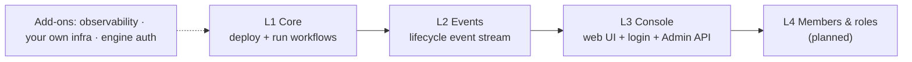

# DWS OpenWiki quickstart

**DWS runs [Open Workflow Specification](https://open-workflow-specification.org/) (DSL 1.0)
workflows on Kubernetes as durable Dapr Workflows — without writing workflow code.** You `POST` a
YAML/JSON definition; DWS validates it, deploys what it needs, and runs it on prebuilt images.

## Pick your layer

DWS features switch on in layers, from the core outward. Start at Core; add only what you need.



| I want to… | Read |
|---|---|
| Understand the layers and today's vs planned Helm values | [Feature layers](user-guide/feature-layers.md) |
| Install DWS, deploy a workflow, start/query/terminate an instance | [Core engine](user-guide/core-engine.md) |
| React to deploys and runs from my own systems; the event contract | [Events](user-guide/events.md) |
| Use the web console, sign in, query run history | [Console](user-guide/console.md) |
| Add tracing, use my own Postgres/Redis/OTLP, secure machine callers | [Add-ons](user-guide/add-ons.md) |

> **Status.** The layer model is decided but **not built yet** (Helm roadmap Phase 12). Each guide
> page separates **Today** (chart 1.x values) from **Planned** (chart 2.0).

## Five-minute path

```sh
# 1. Install (Knative Serving must already be in the cluster)
helm install dws oci://ghcr.io/tonylibs/charts/dws -n dws-system --create-namespace

# 2. Deploy a workflow
kubectl -n dws-system port-forward svc/dws-controller 8080:80 &
curl -s -H 'Content-Type: application/yaml' --data-binary @order.yaml localhost:8080/workflows

# 3. Run it
kubectl -n dws-system port-forward deploy/order-<versionId> 8081:8080 &
curl -s -XPOST localhost:8081/workflows/order/instances -d '{"orderId": 42}'
```

Full walkthrough with responses and the Dapr Workflow API: [Core engine](user-guide/core-engine.md).

## Under the hood (contributors)

How the pieces work, for people changing DWS:

- [Deployed workflow lifecycle](architecture/deployed-workflow.md) — definition → versioned resources → generic interpreter.
- [Lifecycle events](integrations/lifecycle-events.md) — publishers, replay determinism, known replay defect.
- [Administrative read model](integrations/admin-read-model.md) — `dws-admin` projection, queries, SSE, submission relay.
- Step runtimes: [HTTP](integrations/http-step-runner.md), [OpenAPI](integrations/openapi-step-runner.md), [gRPC & AsyncAPI](integrations/protocol-step-runners.md), [A2A](integrations/a2a-step-runner.md).
- Runtime v2 (early): [DWS Flow workflow host](architecture/flow-host.md), [DWS Step activity host](integrations/step-activity-host.md).
- [Console OIDC login](architecture/console-auth.md) — browser PKCE login and the Dex agreement.
- [Helm chart packaging](architecture/helm-chart-roadmap.md) — chart internals, auth pipeline placement, CI and release.
- [OWS DSL feature roadmap](architecture/roadmap.md) — DSL coverage vs implementation.
- [Agent sandbox](architecture/agent-sandbox.md) — development image and session templates.

| Component | Responsibility | Check (run inside the component dir) |
|---|---|---|
| `dws-controller` | Validates/compiles definitions, applies Kubernetes resources | `./mvnw verify` |
| `dws-orchestrator` | Default runtime: interprets one pinned definition per pod | `./mvnw verify` |
| `dws-step` / `dws-flow` | Runtime v2 per-node hosts (early) | `./mvnw verify` / `dotnet test test/dws-flow.Tests.csproj` |
| `dws-call-http`, `dws-call-grpc`, `dws-run` | Go step images | `make lint && make test` |
| `dws-call-openapi`, `dws-call-asyncapi` | TypeScript step images | `pnpm lint && pnpm test && pnpm build` |
| `dws-call-a2a` | Python step image | `uv run ruff check . && uv run pyright && uv run pytest` |
| `dws-admin` | Admin API: lifecycle-event projection + queries | `pnpm lint && pnpm test && pnpm build` |
| `dws-console` | Web UI | `pnpm check && pnpm typecheck && pnpm test && pnpm build` |
| `charts/dws` | Helm chart | `helm lint charts/dws` + `charts/dws/tests/*.sh` (from repo root) |

Scope and audience for this wiki are set in [`INSTRUCTIONS.md`](INSTRUCTIONS.md). The workflow
`.github/workflows/openwiki-update.yml` refreshes it after merges to `main`.

## Backlog

- **Members & roles (L4)** — `docs/roadmaps/helm-packaging.md`: not broken down yet; only a placeholder in [Console](user-guide/console.md#members--roles-planned).
- **Run step-runner internals** — `dws-run/`: request/response and configuration details not documented; comparable runners are under `integrations/`.
- **Console browser internals** — `dws-console/`: routes, caching and deployment details deferred; user-facing behavior is in [Console](user-guide/console.md).
