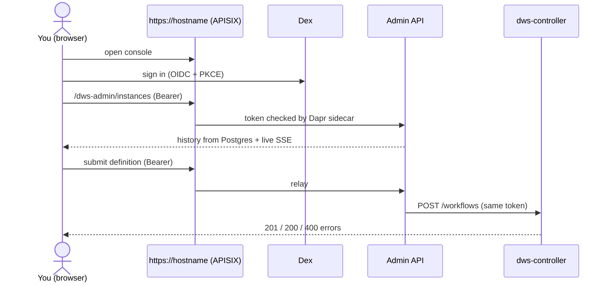

# Console (L3)

A web UI for DWS behind one login. The layer brings five things up together:

| Component | Role for you |
|---|---|
| `dws-console` | The UI |
| Admin API (`dws-admin`) + Postgres | Run history, queries, live updates, submission relay |
| Dex | OIDC sign-in; one bootstrap admin account |
| APISIX + Gateway API | One front door: `https://<hostname>` (UI) and `/dws-admin` (Admin API) |
| Bearer check on Admin API + controller | Every call needs a signed-in token |

Needs [Events](events.md) (history is built from lifecycle events) and [Core](core-engine.md)
(submissions go to the controller).

## What you can do

| Feature | Built from |
|---|---|
| **Sign in** with OIDC (bundled Dex, one admin account) | — |
| **Workflow browser** — workflows, versions, deployment status | `definition.*`, `deployment.*` events |
| **Instance monitor** — list, filter by status, detail, task timeline | `instance.*`, `task.*` events |
| **Live updates** on running instances | same events, pushed as they arrive |
| **Submit a definition** — editor, file import, draft kept in the browser, diagram, preview (spec check + dry-run plan), deploy | Admin API → controller |

Not yet: start / cancel / retry an instance from the console. Use the
[Core APIs](core-engine.md#3-run-an-instance).



## Turn it on

### Planned (chart 2.0, task 12.3d)

```yaml
console:
  enabled: true
  hostname: dws.example.com
```

`helm upgrade --set console.enabled=true --set console.hostname=…` on a Core-only release works.
Install notes print the console URL and how to read the bootstrap admin password.
Dex is served at `https://<hostname>/dex`; issuer and redirect URIs derive from the hostname.

### Today (chart 1.x)

Several values must agree. Fresh install with everything bundled:

```sh
helm install dws oci://ghcr.io/tonylibs/charts/dws -n dws-system --create-namespace \
  --set console.enabled=true \
  --set apiGateway.enabled=true --set apiGateway.hostname=dws.example.com \
  --set apisix.enabled=true \
  --set auth.enabled=true --set auth.dex.enabled=true \
  --set dex.enabled=true \
  --set dex.issuer=https://<browser-reachable-dex>/dex \
  --set dex.consoleRedirectURI=https://dws.example.com/
```

| Value | Why |
|---|---|
| `console.enabled` | The UI pods |
| `apiGateway.enabled` + `hostname` (+ `tls.*`) | The front door. Requires `console`, `admin`, `auth` on |
| `apisix.enabled=true` **or** `apiGateway.external.gatewayProxyName` | Bundled APISIX, or your own |
| `auth.enabled` + (`auth.dex.enabled` **or** `auth.issuer`/`audience`) | Token check on Admin API and controller |
| `dex.*` | Bundled IdP and bootstrap admin |
| `admin.enabled`, `postgresql.enabled` | Already on by default |

Bootstrap admin login:

```sh
kubectl -n dws-system get secret dws-dex-admin-credentials -o jsonpath='{.data.email}' | base64 -d
kubectl -n dws-system get secret dws-dex-admin-credentials -o jsonpath='{.data.password}' | base64 -d
```

(Secret name for release `dws`; it is `<fullname>-dex-admin-credentials` in general.)

`helm install` prints the exact commands (`NOTES.txt`). Or bring the password with
`dex.adminUser.existingSecret`.

**Watch out (today)**

| Trap | Fix |
|---|---|
| `apisix.enabled=true` on `helm upgrade` **hangs** (etcd pre-upgrade hook) | Fresh install only, or run APISIX as its own release + `apiGateway.external.gatewayProxyName`. Fixed by 12.3b |
| Console image bakes its OIDC issuer and Admin API URL at **build** time (`VITE_OIDC_ISSUER_URI`, default `http://dex.dws.local/dex`; `VITE_DWS_ADMIN_URL`, default `/dws-admin`) | Make Dex reachable at that issuer, or rebuild the image. Fixed by 12.3a (settings read at start) |
| Dex is not routed through the gateway | Expose it yourself. Fixed by 12.3c |
| `auth.enabled=true` changes the controller Service to the Dapr sidecar | Direct callers must use Dapr invoke + token ([Core](core-engine.md#2-submit-a-workflow)) |
| Bundled Dex: no silent token renew, no provider logout | Expect re-login; provider change is Auth roadmap Phase 8 |
| `console.ingress.enabled` | Removed — fails with migration steps ([chart README](../../charts/dws/README.md)) |

## Admin API (use it directly)

Same API the console uses, at `https://<hostname>/dws-admin/…`, with the signed-in bearer token.

| Endpoint | Returns |
|---|---|
| `GET /workflows`, `/workflows/:name`, `/workflows/:name/deployments` | Workflows, versions, deploy status |
| `GET /instances?workflow=&status=`, `/instances/:id`, `/instances/:id/tasks` | Runs and task timeline (paginated) |
| `GET /instances/events` | SSE: status changes for all instances |
| `GET /instances/:id/events` | SSE: one instance until it ends |
| `POST /workflows[?dryRun=true]` | Relays a definition to the controller, response unchanged |

**Watch out:** history is a *view* built from events, not the source of truth. A lost event leaves
a row wrong (accepted v1 gap; durable broker recommended for production). SSE has no replay:
re-read the `GET` after reconnecting. Run one Admin API replica — live push is in-process.

## Members & roles (planned)

L4, wrapping the console. Not built and not broken down yet.

| | Console (L3) | Members & roles (L4) |
|---|---|---|
| Users | One admin account | Many users |
| Permissions | Admin can do everything | Roles (RBAC) |
| Identity | OIDC (bundled Dex) | OIDC with an issuer that supplies many identities; user management |

## Under the hood

[Console OIDC login](../architecture/console-auth.md) · [Administrative read model](../integrations/admin-read-model.md) ·
[Helm chart packaging](../architecture/helm-chart-roadmap.md) ·
roadmaps [`dws-console.md`](../../docs/roadmaps/dws-console.md), [`dws-auth.md`](../../docs/roadmaps/dws-auth.md),
[`helm-packaging.md`](../../docs/roadmaps/helm-packaging.md) (decisions 9–11, tasks 12.3a–e).
