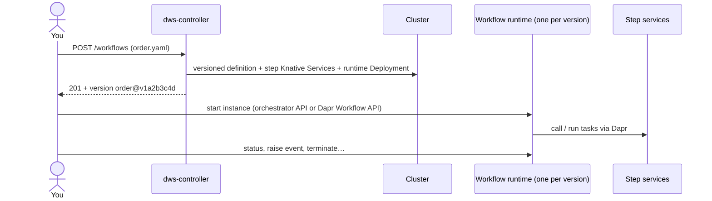

# Core engine (L1)

Core is everything an OWS workflow needs to run: the **engine** (controller + workflow runtime),
the **step runtimes** (one prebuilt image per `call`/`run` kind) and **triggers**. It is always on.



## 1. Install

**Prerequisites (today)**

| Need | Note |
|---|---|
| Kubernetes + Helm 4 | CI pins Helm 4.3.0 |
| **Knative Serving** | Every `call`/`run` task runs as a scale-to-zero Knative Service. **Not installed by the chart today** — install it first. Planned: bundled in Core (task 12.1b) |
| Dapr 1.18+ | Bundled by default (`dapr.enabled=true`, chart pins 1.18.7). Bring your own with `dapr.enabled=false`; a preflight fails fast if Dapr's CRDs are missing |

**Install**

```sh
helm install dws oci://ghcr.io/tonylibs/charts/dws \
  --namespace dws-system --create-namespace --timeout 5m
helm test dws --namespace dws-system --logs      # optional smoke test
```

| | Today (1.x) | Planned (2.0) |
|---|---|---|
| Default install | Controller, Dapr, Redis **plus** Admin API + Postgres | Core only |
| Core-only install | Closest today: `--set admin.enabled=false --set postgresql.enabled=false` | The default |
| How you reach the engine | Port-forward / Dapr invoke to `dws-controller` (no public route by design) | Same; install notes print how |

## 2. Submit a workflow

Write a DSL 1.0 document (`order.yaml`) and `POST` it. The controller validates, compiles and
deploys it.

```sh
kubectl -n dws-system port-forward svc/dws-controller 8080:80 &

# Validate only — shows the deployment plan, changes nothing
curl -s -H 'Content-Type: application/yaml' --data-binary @order.yaml \
  'localhost:8080/workflows?dryRun=true'

# Deploy
curl -s -H 'Content-Type: application/yaml' --data-binary @order.yaml localhost:8080/workflows
# {"workflow":"order","versionId":"v1a2b3c4d","version":"order@v1a2b3c4d","created":true}
```

| Response | Meaning |
|---|---|
| `201` | New version deployed |
| `200` | Same content already deployed — no-op (`"created": false`) |
| `400` | Invalid definition; body lists every error |

| Endpoint | Does |
|---|---|
| `POST /workflows[?dryRun=true]` | Validate (+ deploy). YAML or JSON body |
| `GET /workflows`, `GET /workflows/{name}` | What is deployed |
| `GET /workflows/{name}/plan` | The compiled plan |
| `DELETE /workflows/{name}` | Remove every version (`204`) |

**Versioning, from your side**

- Version = hash of the content. Edit and re-post → a new version deploys **next to** the old one.
- The old version is drained, then removed once its runtime reports zero replicas.
- Task names must be unique across the whole document (they name the step services).

**With auth on.** If `auth.enabled=true` (today) — or the console is on (planned, decision 11) —
the controller only accepts calls through Dapr with a valid bearer token:

```sh
curl -s -H "Authorization: Bearer $TOKEN" -H 'Content-Type: application/yaml' \
  --data-binary @order.yaml \
  localhost:8080/v1.0/invoke/dws-controller/method/workflows   # Service now fronts the Dapr sidecar
```

Machine tokens for CI ("engine auth") are not designed yet — see [Add-ons](add-ons.md#engine-auth-planned).

## 3. Run an instance

Each version gets its own runtime Deployment (label `dws.io/workflow=<name>`). Its Dapr app ID is
the kebab-cased `document.name`; the Dapr workflow it registers is named exactly `document.name`.

```sh
kubectl -n dws-system get deploy -l dws.io/workflow=order
```

Pick one of three ways in:

| Way | Use when | Can do |
|---|---|---|
| **A. Orchestrator API** | Simplest, from a port-forward | Start, status + output, raise event |
| **B. Dapr Workflow API** | You want Dapr's full instance control, or your own instance IDs | Start, status, raise event, **terminate, pause, resume, purge** |
| **C. Dapr service invocation** | Another Dapr app in the cluster starts it | Same as A, no port-forward |

### A. Orchestrator API

```sh
kubectl -n dws-system port-forward deploy/order-<versionId> 8081:8080 &

curl -s -XPOST localhost:8081/workflows/order/instances \
  -H 'content-type: application/json' -d '{"orderId": 42}'
# 202 {"instanceId":"<id>","workflowName":"order"}

curl -s localhost:8081/workflows/instances/<id>                    # {instanceId, runtimeStatus, output}
curl -s -XPOST localhost:8081/workflows/instances/<id>/events/approval -d '{"ok":true}'   # feeds `listen`
```

The pod serves one workflow: any other name in the start path returns `404`.

### B. Dapr Workflow API (on the runtime's own sidecar)

```sh
kubectl -n dws-system port-forward deploy/order-<versionId> 3500:3500 &
D=localhost:3500/v1.0/workflows/dapr

curl -s -XPOST "$D/order/start?instanceID=order-42" -H 'content-type: application/json' -d '{"orderId": 42}'
curl -s "$D/order-42"                                   # status
curl -s -XPOST "$D/order-42/raiseEvent/approval" -d '{"ok":true}'
curl -s -XPOST "$D/order-42/pause"   ;  curl -s -XPOST "$D/order-42/resume"
curl -s -XPOST "$D/order-42/terminate"
curl -s -XPOST "$D/order-42/purge"                      # delete its history
```

### C. From another Dapr app

```sh
curl -s -XPOST localhost:3500/v1.0/invoke/order/method/workflows/order/instances -d '{"orderId": 42}'
```

**Watch out**

- `terminate`/`pause`/`purge` go straight to Dapr: DWS publishes no lifecycle event for them, so
  [Events](events.md) consumers and the [Console](console.md) never see that state change.
- A runtime serves **one version**. New instances should target the newest version's Deployment;
  instances on a drained version finish there.
- No cancel/retry endpoint on the orchestrator API yet — use the Dapr Workflow API.

## 4. What a workflow can do

| Area | Today | Not yet |
|---|---|---|
| Calls (step runtimes) | `call: http`, `openapi`, `grpc` (unary), `asyncapi` (`send`), `a2a` | gRPC/A2A streaming |
| Run | `run: shell`, `run: script` (JS, Python) | `run: container`, `run: workflow` |
| Control flow | `switch`, `set`, `for`/`while`, `fork`, `try`/`catch`/`retry`, `raise`, nested `do` | — |
| Events & time | `wait`, `listen` (one external event), `emit` (Dapr pub/sub, topic = kebab task name) | `listen` correlation |
| Errors, timeouts | RFC 7807 errors, task + workflow `timeout` | — |
| Auth & secrets | `basic`, `bearer`, `oauth2` client credentials; `use.secrets` → Kubernetes Secrets | — |
| Reuse | — | `use.functions`, `use.catalogs`, `use.extensions` |

Full matrix: [`docs/roadmaps/openworkflow-features.md`](../../docs/roadmaps/openworkflow-features.md).

### Triggers

| Trigger | Status |
|---|---|
| Deploy on `POST`, start via API (A/B/C above) | Today |
| `listen` waits for an event you raise on the instance | Today |
| `schedule` (`every`, `cron`, `after`, `on`) | Not built (OWS roadmap Phase 6) — part of Core when it lands |
| Chaining one workflow on another's lifecycle events | Planned in Core via `listen` / `schedule.on`, fed by the [Events](events.md) layer |

## Under the hood

How a definition becomes resources and how the interpreter walks it:
[Deployed workflow lifecycle](../architecture/deployed-workflow.md). Per-runtime contracts:
[HTTP](../integrations/http-step-runner.md), [OpenAPI](../integrations/openapi-step-runner.md),
[gRPC & AsyncAPI](../integrations/protocol-step-runners.md), [A2A](../integrations/a2a-step-runner.md).
Controller reference: [`dws-controller/k8s/README.md`](../../dws-controller/k8s/README.md).
