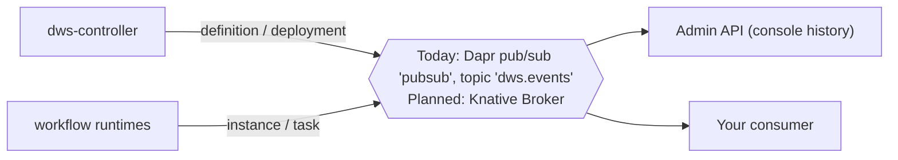

# Events (L2)

DWS tells you what it is doing as a stream of **lifecycle events**: a definition was created, a
version deployed, an instance started, a task failed. Plug your own systems in without polling.

| You want | Listen for |
|---|---|
| Alert when a run fails | `io.dws.instance.failed` |
| Track deploys in CI / chat | `io.dws.deployment.applied` / `.failed` |
| Build your own run history or dashboard | `io.dws.instance.*`, `io.dws.task.*` |
| Audit which workflow versions exist | `io.dws.definition.*` |

> **Not the same as `emit`.** A workflow's own `emit` task publishes *your* data to a topic named
> after the task. That is Core. Lifecycle events are DWS's own telemetry, described here.

## How to consume



| | Today (1.x) | Planned (Events layer, Phase 12.2) |
|---|---|---|
| On/off | Always on while Dapr is on | `events.enabled` (shape open); Console turns it on. **Core alone publishes nothing** |
| Transport | Dapr pub/sub component `pubsub`, topic `dws.events` (Redis) | Knative Eventing **Broker**, in-memory for v1 |
| How you subscribe | A Dapr app with a `Subscription` to `pubsub` / `dws.events` | A Knative **Trigger** on the DWS Broker → any URL, Knative sink, or Camel K Kamelet |
| Wire format | Dapr wraps the DWS envelope as its CloudEvent `data` | The DWS event *is* the CloudEvent |
| Contract | `docs/events.md` (unversioned) | Versioned `io.dws.*` CloudEvents 1.0 (task 12.2a) |

### Today: subscribe with Dapr

Run your consumer as a Dapr app in the release namespace and declare:

```yaml
apiVersion: dapr.io/v2alpha1
kind: Subscription
metadata:
  name: my-dws-events
spec:
  pubsubname: pubsub
  topic: dws.events
  routes:
    default: /dws-events
scopes: [my-consumer]          # your Dapr app ID
```

Your `POST /dws-events` handler receives Dapr's CloudEvent; the DWS event is its `data`
(JSON object or JSON text). Route on `data.type`.

### Planned: attach a Knative Trigger

```yaml
apiVersion: eventing.knative.dev/v1
kind: Trigger
metadata:
  name: alert-on-failure
spec:
  broker: <dws-broker>                  # name set by the chart (not fixed yet)
  filter:
    attributes:
      type: io.dws.instance.failed
  subscriber:
    uri: https://hooks.example.com/dws
```

## The event contract

Every event is a CloudEvents-style JSON envelope:

| Field | Value |
|---|---|
| `id` | Unique per event (runtime events: `<instanceId>-<n>`, stable across replays) |
| `source` | `dws-controller` or `dws-orchestrator/<appId>` |
| `type` | One of the types below |
| `time` | RFC 3339 UTC |
| `datacontenttype` | `application/json` |
| `data` | Per-type payload |

| Type | Sent when | `data` |
|---|---|---|
| `io.dws.definition.created` | A new version's definition is stored | `workflow`, `version`, `createdAt` |
| `io.dws.definition.updated` | Same content re-posted | same |
| `io.dws.deployment.applied` | Version deployed | `workflow`, `version`, `stepServices[]`, `orchestratorAppId` |
| `io.dws.deployment.failed` | Deploy failed | same + `error` |
| `io.dws.deployment.drained` | Old version told to drain | `workflow`, `version`, `orchestratorAppId` |
| `io.dws.deployment.collected` | Old version removed | same |
| `io.dws.instance.started` | Run begins | `instanceId`, `workflow`, `version`, `appId`, `startedAt` |
| `io.dws.instance.completed` | Run ends OK | + `endedAt` |
| `io.dws.instance.failed` | Run ends with error | + `endedAt`, `error` |
| `io.dws.task.started` / `.completed` / `.failed` | Around each task | `instanceId`, `taskName`, `taskType`, `timestamp` (+ `error`) |

Full payload examples: [`docs/events.md`](../../docs/events.md).

## Delivery — what to expect

| Property | Behavior |
|---|---|
| Best-effort | A publish failure never fails a deploy or a run; the event is just missing |
| Duplicates | Possible — dedupe on `id` |
| Order | Not guaranteed — e.g. `completed` can arrive before `started`; treat terminal states as final |
| Replay / retention | None today, none in Events v1 |
| Not reported | Instances you `terminate`/`pause`/`purge` through the Dapr Workflow API ([Core](core-engine.md#b-dapr-workflow-api-on-the-runtimes-own-sidecar)) |

**Watch out (planned v1):** the in-memory Broker loses events on restart. Consumers — including the
[Console](console.md) history — can stay wrong (an instance shown "running" forever). For
production, use a durable broker from your own infra ([Add-ons](add-ons.md#bring-your-own-infra)).

Parked for later: retention + replay, webhook sinks with retries/dead-letter, per-sink filters,
your own broker (Kafka, NATS, RabbitMQ).

## Under the hood

Publishers, replay determinism and the known replay defect: [Lifecycle events](../integrations/lifecycle-events.md).
How the Admin API projects them: [Administrative read model](../integrations/admin-read-model.md).
Design: [`docs/roadmaps/helm-packaging.md`](../../docs/roadmaps/helm-packaging.md) decisions 13–16, 18.
