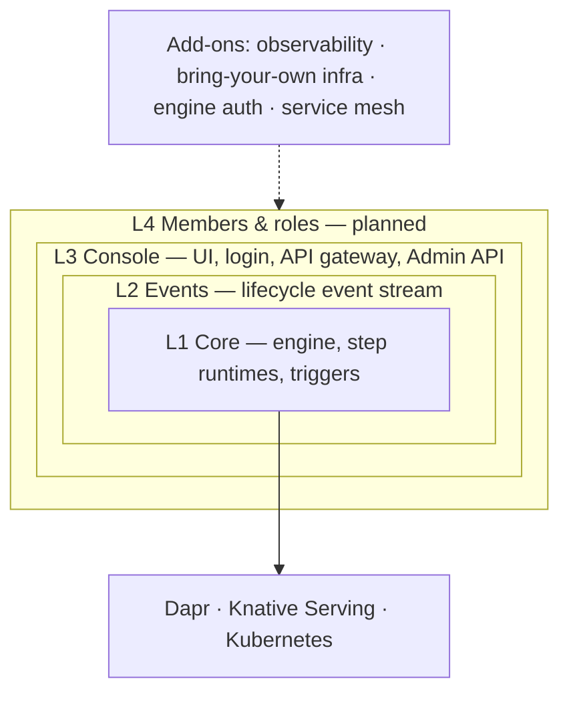

# Feature layers

DWS is installed as one Helm chart (`charts/dws`). Features are grouped into **layers**: start with
the core engine, then switch on the layers you need. Each layer needs the ones inside it.
Add-ons sit beside the layers and work with any of them.



| Layer | You get | Page |
|---|---|---|
| **L1 Core** | Deploy OWS workflows with `POST`, run and query instances. Always on | [Core engine](core-engine.md) |
| **L2 Events** | A stream of definition/deployment/instance/task events for your own systems | [Events](events.md) |
| **L3 Console** | Web UI with login: browse workflows, watch instances live, submit definitions | [Console](console.md) |
| **L4 Members & roles** | Many console users with roles | [Console → Members & roles](console.md#members--roles-planned) |
| Add-ons | Tracing, your own Postgres/Redis/OTLP, machine auth, mesh | [Add-ons](add-ons.md) |

## Status: designed, partly built

The layer model is **decided but not built** (Helm roadmap Phase 12). Today the chart still has one
toggle per component, and some pieces of a layer are always on.

| | Today (chart 1.x) | Planned (chart 2.0, Phase 12) |
|---|---|---|
| Default install | Controller + Dapr + Redis **+ Admin API + Postgres** | Core only |
| Knative Serving | You install it yourself (prerequisite) | Bundled in Core |
| Lifecycle events | Always published on Dapr pub/sub `pubsub` / `dws.events` | Only with the Events layer, via a Knative Broker |
| Console | Several flags: `console`, `apiGateway`, `auth`, `dex`/issuer, `apisix` | One switch: `console.enabled` + `console.hostname` |
| Turning the console on later | `apisix.enabled=true` hangs on `helm upgrade` | `helm upgrade --set console.enabled=true` works |
| Controller API with console on | Bearer token required only if `auth.enabled=true` | Dex token required whenever the console is on |

## Today's values, grouped by layer

| Layer | Values (chart 1.x) | Default |
|---|---|---|
| L1 Core | `controller.*`, `controller.images.*`, `dapr.enabled` (+ its Redis), `redis.external.host` | on |
| L2 Events | none — always published while Dapr is on | on |
| L3 Console | `admin.enabled`, `postgresql.enabled` | **on** |
| L3 Console | `console.enabled`, `apiGateway.*`, `apisix.enabled`, `auth.*`, `dex.*` | off |
| Add-on | `observability.*` | off |
| Add-on | `admin.database.*`, `redis.external.host`, `observability.otlp.endpoint` | — |

Annotated source of truth: [`charts/dws/values.yaml`](../../charts/dws/values.yaml).

## Planned switches (chart 2.0)

```yaml
# Core is always on — no switch.
events:
  enabled: true              # L2 — shape still open ("events.enabled" sketched)
console:
  enabled: true              # L3 — also turns Events on
  hostname: dws.example.com  # required with the console
```

| Rule | Behavior |
|---|---|
| Outer needs inner | Console on ⇒ Events on |
| Old per-component flags | `admin.enabled`, `postgresql.enabled`, `apisix.enabled`, `apiGateway.enabled`, `dex.enabled`, `auth.enabled` fail with "moved to `console.enabled`" |
| Everything bundled | Each layer brings its own Postgres/Broker/Dex/APISIX; swapping in your own infra is a separate add-on (Phase 13) |

Delivery order (from the roadmap): Core 12.1a–c → Events 12.2a–e → Console 12.3a–e → Members later.

## Source

- [`docs/roadmaps/helm-packaging.md`](../../docs/roadmaps/helm-packaging.md) — "Design direction" (decisions 1–18) and "Phase 12 breakdown"
- [`docs/adr/0008-chart-bring-your-own-infra.md`](../../docs/adr/0008-chart-bring-your-own-infra.md)
- [`docs/adr/0007-chart-feature-layers.md`](../../docs/adr/0007-chart-feature-layers.md) — earlier proposal; its layer numbering is superseded by the roadmap
